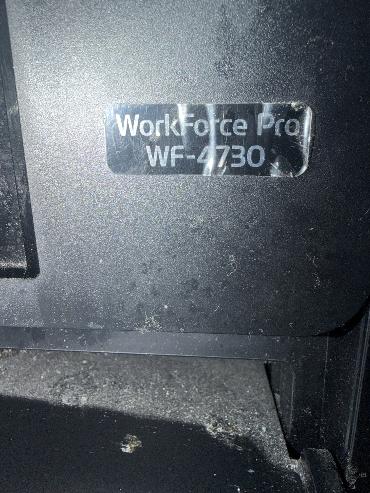
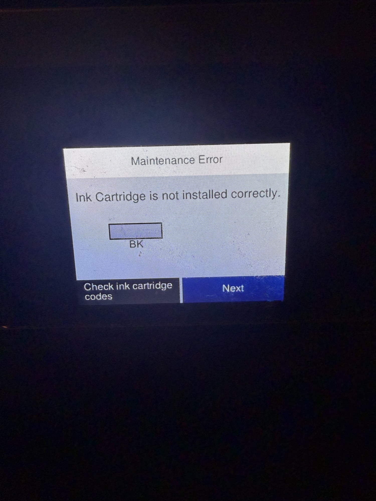
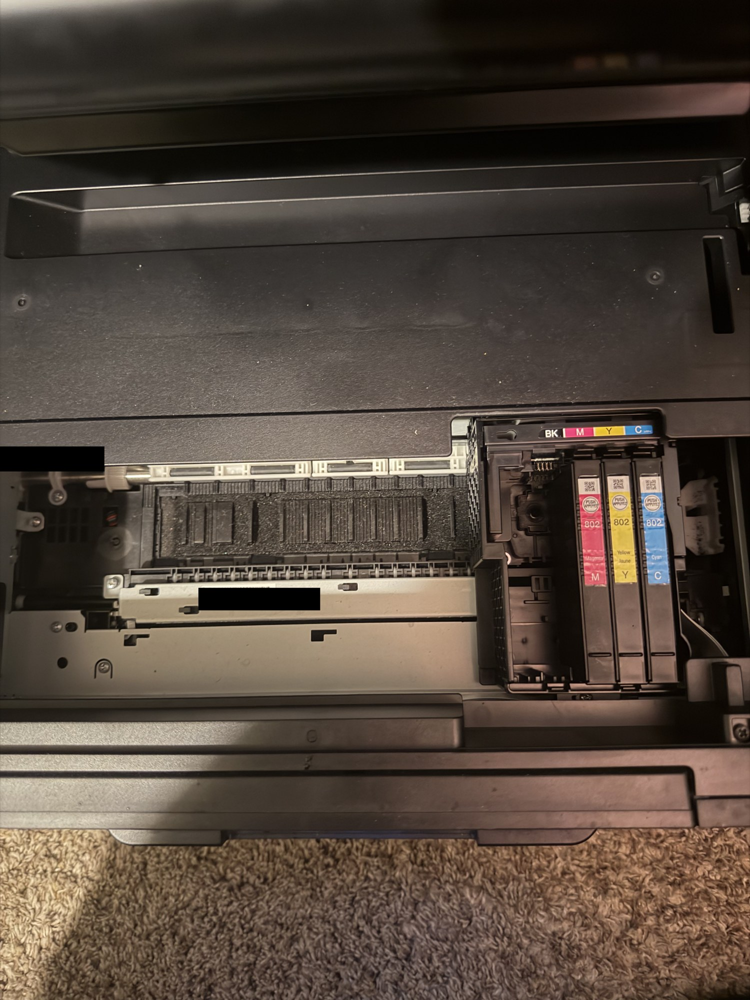

# Epson WF-4730 Printer Troubleshooting

**Status: Paused — power restored; printing not yet verified.**  
**Last updated: October 29, 2026**

## Overview
A client reported that her printer would not turn on and had experienced printing problems in the past. She had already purchased a replacement. I inspected the original Epson WorkForce Pro WF-4730 to isolate the problems and document the findings.

## Troubleshooting completed

| Phase | Action / observation | Result |
|---|---|---|
| 1. Gather symptoms | Recorded the client's report of no power and earlier printing problems. | Established the starting symptoms; prior printing faults remain unspecified. |
| 2. Test power | Substituted a different power cord. | Printer powered on. Original cord or its connection is the suspected source of the power issue; no electrical testing was performed. |
| 3. Record error | Observed “Maintenance Error: Ink Cartridge is not installed correctly.” The display identified BK. | Narrowed investigation to the black cartridge. |
| 4. Inspect cartridges | Visually inspected the cartridge carriage. | Black cartridge slot was empty. Magenta, yellow, and cyan cartridges were present in their labeled positions. |

## Current findings
- The printer powers on with the substituted cord, according to the hands-on test.
- The missing black cartridge is consistent with the displayed BK installation error.
- The cartridge photo shows no obvious jam or broken component in the visible area. This is a limited visual inspection, not a complete hardware assessment.
- Color cartridge levels, recognition, and seating have not been verified.
- The cause of the client's earlier printing problems is not yet established.

## Photo evidence

### Printer identification

### Black cartridge error

### Missing black cartridge

Photos are resized JPEG copies for convenient viewing. Device identifier labels in the internal view are obscured. Original files are retained separately by the project owner. No photo or video is presented as proof of a successful print.

## Resume checklist
- [ ] Confirm the replacement power cord meets the printer's requirements.
- [ ] Install a compatible black cartridge using Epson's procedure (802 or 802XL for the US/Canada WF-4730).
- [ ] Record whether the BK error clears and whether other cartridge errors appear.
- [ ] Run a nozzle check and photograph the output.
- [ ] Follow manufacturer guidance if the nozzle pattern has gaps.
- [ ] Test a standalone copy and a document printed from a computer.
- [ ] Record print quality, connection method, and final outcome.

## Skills demonstrated
- Gathering client symptoms
- Isolating a power problem through component substitution
- Interpreting a device error message
- Visual hardware inspection
- Separating confirmed findings from unresolved symptoms
- Recording evidence and planning validation

## Manufacturer references
- [WF-4730 cartridge part numbers](https://files.support.epson.com/docid/cpd5/cpd53013/source/printers/source/ink_functions/reference/ink_part_numbers_us_canada_wf3720_4734.html)
- [Removing and installing cartridges](https://files.support.epson.com/docid/cpd5/cpd53013/source/printers/source/ink_functions/tasks/wf3720_4730/removing_installing_cartridges_wf3720_4730.html)

## Project outcome so far
Restored power through cord substitution and identified an absent black cartridge while investigating an installation error. The project is paused before cartridge replacement and print validation; a complete repair is not claimed.
