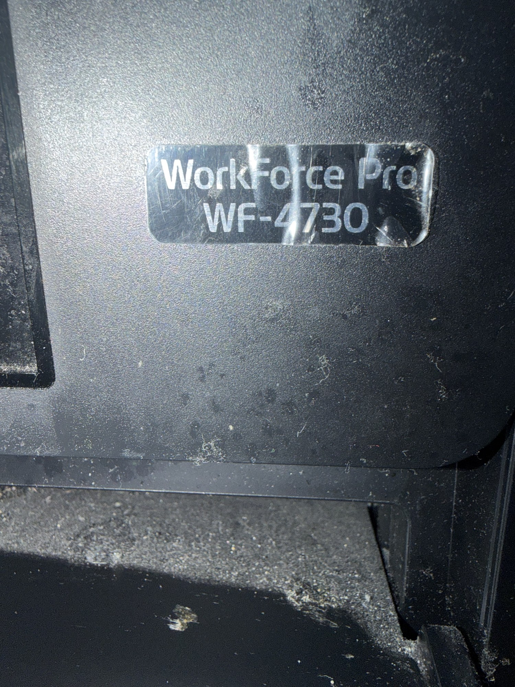
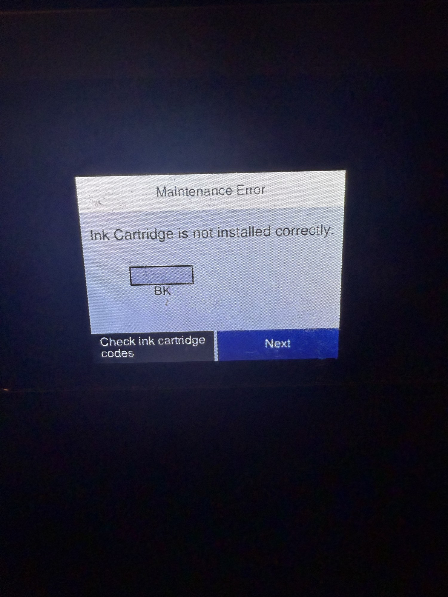
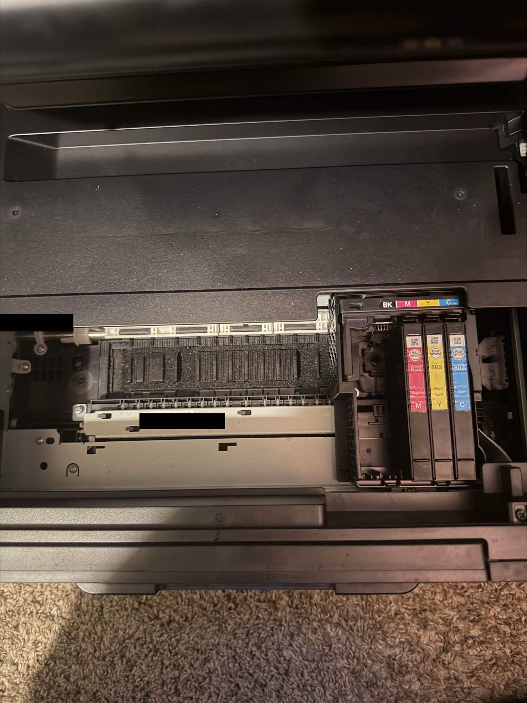

# Epson WF-4730 Printer Troubleshooting

**Status: In progress — both visible test blocks show continuous lines; document and full-color validation pending.**  
**Last updated: November 12, 2026**

## Overview
A client reported that her printer would not turn on and had experienced printing problems in the past. She had already purchased a replacement. I inspected the original Epson WorkForce Pro WF-4730 to isolate the problems and document the findings.

## Troubleshooting completed

| Phase | Action / observation | Result |
|---|---|---|
| 1. Gather symptoms | Recorded the client's report of no power and earlier printing problems. | Established the starting symptoms; prior printing faults remain unspecified. |
| 2. Test power | Substituted a different power cord. | Printer powered on. Original cord or its connection is the suspected source of the power issue; no electrical testing was performed. |
| 3. Record error | Observed “Maintenance Error: Ink Cartridge is not installed correctly.” The display identified BK. | Narrowed investigation to the black cartridge. |
| 4. Inspect cartridges | Visually inspected the cartridge carriage. | Black cartridge slot was empty. Magenta, yellow, and cyan cartridges were present in their labeled positions. |

| 5. Replace cartridges | Replaced cartridges; photo shows an 802XL black cartridge installed. | Project owner reports cartridge errors cleared. |
| 6. Attempt printing | Printer displayed “Printing…”; subsequent photo shows Printer Error 000084. | Successful printing remains unverified; cause under investigation. |

## Current findings
- Latest correction (IMG_1272): the clearer photo and owner's inspection show continuous lines in both visible blocks. The earlier assessment of gaps in IMG_1271 is withdrawn. Further cleaning is not indicated solely by those two blocks. Full-color and normal-document testing remain pending.
- Follow-up: owner reported an initially blank control-panel nozzle check. New photos IMG_1264–IMG_1268 show head cleaning in progress, a manual pattern-comparison screen, and printed line blocks with missing sections. Ink output is now visible, but a complete nozzle pattern and normal document printing are not verified. Exact cleaning count and recurrence of 000084 are not yet confirmed.
- Power was restored by substituting the cord; the original cord/connection remains suspected.
- The previously missing black cartridge is now installed (802XL label visible). The project owner reports replacing cartridges and clearing the installation errors.
- New evidence shows a “Printing…” screen and Printer Error **000084**, requesting a restart.
- A separate information screen recommends a Print Head Nozzle Check. This is not proof of a clogged or failed printhead.
- The supplied network screenshot lists a DIRECT network, but does not establish a successful printer connection.
- The specific cause of 000084 is unconfirmed. No successful page or completed nozzle pattern has been supplied.

## Photo evidence

### Printer identification

### Black cartridge error

### Missing black cartridge

Photos are resized JPEG copies for convenient viewing. Device identifier labels in the internal view are obscured. Original files are retained separately by the project owner. No photo or video is presented as proof of a successful print.

## November 12 update
Testing resumed after cartridge replacement. See the [dated troubleshooting entry](updates/2026-11-12.md) for the new symptoms, evidence inventory, and planned isolation tests.

## Next troubleshooting checklist
- [ ] Confirm the replacement power cord meets the printer's requirements.
- [x] Install black cartridge (802XL visible in new photo).
- [x] Record cartridge-error result: cleared per project owner; new 000084 printer error documented.
- [ ] Cancel pending external jobs, restart normally, and inspect for accessible obstructions if the error persists.
- [ ] With no active errors, run a nozzle check from the printer control panel and photograph the output or recurring error.
- [ ] Follow manufacturer guidance if the nozzle pattern has gaps.
- [ ] Test a standalone copy and a document printed from a computer.
- [ ] Record print quality, connection method, and final outcome.

## Skills demonstrated
- Gathering client symptoms
- Isolating a power problem through component substitution
- Interpreting a device error message
- Visual hardware inspection
- Separating confirmed findings from unresolved symptoms
- Recording evidence and planning validation

## Manufacturer references
- [WF-4730 cartridge part numbers](https://files.support.epson.com/docid/cpd5/cpd53013/source/printers/source/ink_functions/reference/ink_part_numbers_us_canada_wf3720_4734.html)
- [Removing and installing cartridges](https://files.support.epson.com/docid/cpd5/cpd53013/source/printers/source/ink_functions/tasks/wf3720_4730/removing_installing_cartridges_wf3720_4730.html)

## Project outcome so far
Restored power through cord substitution and identified an absent black cartridge while investigating an installation error. Cartridges have since been replaced and the installation error cleared. A new 000084 error appeared during print testing; diagnosis and print validation remain in progress.
